# Software Requirements Specification (SRS)

## Does Removing Names Protect Privacy?
### Structural-signature analysis of an anonymised synthetic social network

| Field | Value |
|---|---|
| Document ID | SRS-WSN-PRIV-001 |
| Version | 1.0 (initial full draft) |
| Date | 22 November 2026 |
| Author | Aditya Kumar |
| Programme | M.Sc. Artificial Intelligence, Central University of South Bihar (CUSB) |
| Course | Wireless Social Network |
| Instructor  | Dr. Nemi Chandra Rathore  |
| Status | Draft for implementation |
| Language / tooling | Python 3, NetworkX |

---

## Table of contents

1. Introduction
2. Overall description
3. Project phases and subphases
4. Functional requirements
5. Data requirements
6. External interface requirements
7. Non-functional requirements
8. Formal definitions and algorithms
9. Design decisions (ADRs)
10. System architecture
11. Verification and validation plan
12. Risk register
13. Expected results and interpretation guide
14. Deliverables, schedule, report and viva preparation
15. Traceability matrix
- Appendix A: Reference implementation sketch
- Appendix B: Edge cases and pitfalls
- Appendix C: Glossary
- Appendix D: Master checklist
- Appendix E: Results template
- Appendix F: Open items and placeholders

---

# 1. Introduction

## 1.1 Purpose

This document specifies, completely and unambiguously, everything needed to design, implement, run, verify, report and defend the course project **"Does Removing Names Protect Privacy?"**

The project question is:

> Is replacing people's names sufficient to hide distinctive structural patterns in a social network?

The SRS is the single source of truth. A reader who has never seen the project should be able to rebuild it from this file alone.

## 1.2 Scope

### 1.2.1 In scope

- Generate one undirected synthetic network of about 100 fictional users (default exactly 100).
- Compute a **structural signature** for each node: the pair `(degree, triangle count)`, using `G.degree()` and `nx.triangles()`.
- Compute the **fraction of nodes whose signature occurs exactly once**.
- Replace names with anonymous identifiers using `nx.relabel_nodes()` and **verify whether that fraction changes**.
- On a **fresh copy**, replace **10 % of the edges** with **previously absent edges**, with no self-loops and with the edge count preserved.
- Compare, before and after perturbation: **signature uniqueness**, **average clustering**, **top-five degree ranking**.
- Explain that distinctive signatures illustrate a **potential** privacy concern but **do not establish** that a person can actually be identified.
- Supporting work: validation, tests, figures, robustness runs over many seeds, written report, viva preparation.

### 1.2.2 Out of scope (explicitly)

- Any real personal data. All users are fictional.
- Directed or weighted graphs, multigraphs, temporal or dynamic graphs.
- Implementing an actual re-identification or de-anonymisation attack.
- Implementing formal privacy mechanisms (k-degree anonymity, differential privacy). They appear only in the discussion.
- Wireless-channel simulation (propagation, MAC, mobility traces). The wireless context is motivational, see 2.1.
- Any web service, database or GUI.

## 1.3 Definitions, acronyms, abbreviations

| Term | Meaning |
|---|---|
| Node / user | A vertex of the graph, one fictional person |
| Edge / tie | An undirected friendship or contact link between two users |
| Degree `d(v)` | Number of edges incident to node `v` |
| Triangle count `t(v)` | Number of triangles that contain `v` (as returned by `nx.triangles`) |
| Signature `σ(v)` | The pair `(d(v), t(v))` |
| Signature class | The set of nodes sharing the same signature |
| Unique node | A node whose signature class has size 1 |
| Unique fraction `U` | (number of unique nodes) / N |
| Anonymisation (naive) | Replacing names by arbitrary identifiers while leaving structure unchanged |
| Perturbation / rewiring | Removing k existing edges and adding k previously absent edges |
| Average clustering `C̄` | Mean of local clustering coefficients (`nx.average_clustering`) |
| Top-five ranking | The five highest-degree nodes in descending degree order |
| Re-identification | Linking an anonymous record to a real person |
| Auxiliary knowledge | Outside information an observer holds about a target |
| WSN | Wireless social network (course context) |
| SRS | Software Requirements Specification |
| ADR | Architecture Decision Record |
| RNG | Random number generator |
| FR / NFR / TC | Functional requirement / non-functional requirement / test case |

## 1.4 References

1. NetworkX documentation: `Graph.degree`, `networkx.triangles`, `networkx.relabel_nodes`, `networkx.average_clustering`, `networkx.non_edges`, `networkx.powerlaw_cluster_graph`.
2. L. Backstrom, C. Dwork, J. Kleinberg, *Wherefore Art Thou R3579X? Anonymized Social Networks, Hidden Patterns, and Structural Steganography*, WWW 2007.
3. A. Narayanan, V. Shmatikov, *De-anonymizing Social Networks*, IEEE Symposium on Security and Privacy, 2009.
4. M. Hay, G. Miklau, D. Jensen, D. Towsley, P. Weis, *Resisting Structural Re-identification in Anonymized Social Networks*, VLDB 2008.
5. K. Liu, E. Terzi, *Towards Identity Anonymization on Graphs*, SIGMOD 2008.
6. L. Sweeney, *k-anonymity: a model for protecting privacy*, 2002.
7. C. Dwork, *Differential Privacy*, ICALP 2006.
8. IEEE 29148 and IEEE 830 for SRS structure (used as a template, not followed word for word).

> Citation details above are given from memory of the literature. **Verify authors, venues and years against the originals before putting them in the final report.**

## 1.5 Document conventions

- **MUST** = mandatory for acceptance. **SHOULD** = expected unless there is a documented reason. **MAY** = optional extension.
- IDs: `FR-<AREA>-<nn>`, `NFR-<nn>`, `TC-<nn>`, `ADR-<nn>`, `R-<nn>` (risk), `H<n>` (hypothesis). Phase numbers are `P<n>`, subphases `P<n>.<m>`.
- Code identifiers appear in `monospace`.
- "Original graph" = the named graph `G_named`. "Anonymised graph" = `G_anon`. "Perturbed graph" = `G_pert`.

## 1.6 How to read this document

- Want the plan? Read Section 3.
- Want the exact rules the code must obey? Read Sections 4 and 8.
- Want to know *why* a choice was made? Read Section 9.
- Want to know how to prove it works? Read Sections 11 and 15.
- Want code? Appendix A.

## 1.7 Concept first: ELI5 and an analogy

**ELI5.** Imagine a school photo where everyone's name tag is covered with tape. You still see that one kid is standing next to exactly 12 friends and is in a very particular number of three-friend groups. Nobody else has that pattern. Even without the name, that kid's *shape in the crowd* is special. Removing the name hid the label but not the shape.

**Analogy.** A city map with street names erased. The roads still connect the same way. A junction with seven roads meeting at odd angles is still easy to spot. Names were never the only thing that makes a place recognisable.

**The twist the project must also teach.** Being recognisable *in the map* is not the same as being *found by a stranger*. A stranger must already know the junction's shape and must know which real place it is. That is why the report must say "potential concern", not "proof of identification".

---

# 2. Overall description

## 2.1 Product perspective and wireless-social-network context

The software is a small, self-contained **research script plus report pipeline**. It does not depend on or integrate with other systems.

Why this matters in a wireless social network course:

- In wireless and mobile social networks, edges often come from **proximity or contact events** (Bluetooth or Wi-Fi encounters, device-to-device links, opportunistic contacts), or from app-level friend lists synchronised over wireless links.
- Operators and researchers often release or share such graphs after replacing user identities with **pseudonyms**.
- Pseudonyms alone leave the **topology** intact. The question of this project is whether the topology by itself leaves distinctive patterns.
- Pseudonymous identifiers in wireless protocols are often rotated. Rotating the identifier does not rotate the underlying structure of who meets whom.

This context is motivational. No radio or mobility model is implemented.

## 2.2 Research questions and hypotheses

**RQ1.** In a synthetic network of about 100 users, what fraction of nodes have a structural signature `(degree, triangles)` that no other node shares?

**RQ2.** Does replacing names with anonymous identifiers change that fraction?

**RQ3.** If 10 % of edges are replaced by previously absent edges (edge count preserved), how do signature uniqueness, average clustering and the top-five degree ranking change?

**RQ4.** What can and cannot be concluded about privacy from the answers?

Hypotheses (to be **tested**, not assumed):

| ID | Hypothesis | Nature |
|---|---|---|
| H1 | Relabelling leaves the unique fraction **exactly** unchanged (identical integer counts). | Mathematical certainty, since relabelling is a graph isomorphism. Tested as a sanity check. |
| H2 | With a heavy-tailed, clustered generator the unique fraction is clearly greater than zero. | Empirical. Value unknown until run. |
| H3 | Random rewiring of 10 % of edges tends to **lower** average clustering. | Reasoned expectation: random removals destroy existing triangles, random additions rarely create many. Direction must be measured. |
| H4 | The unique fraction can move in **either** direction after rewiring. | No directional claim. Measure it. |
| H5 | Top-five **membership** is mostly stable but **order** can shuffle, because hub degrees are close. Added edges are drawn uniformly from non-edges, which favours low-degree nodes, so hubs may regress slightly. | Empirical. Measure it. |

## 2.3 Product functions (summary)

1. Configure and seed.
2. Generate a named synthetic network.
3. Compute signatures.
4. Measure uniqueness.
5. Anonymise via relabelling and leakage-check.
6. Verify invariance.
7. Perturb a fresh copy.
8. Compare three properties (plus supplementary ones).
9. Repeat over many seeds for robustness.
10. Produce tables, figures, machine-readable results and the written interpretation.

## 2.4 User classes

| User | Needs |
|---|---|
| Student (Roxx) | Runs the pipeline, reads results, writes the report, defends in viva |
| Instructor / evaluator | Reads the report, may re-run with the stated seed and compare |
| Peer reviewer | Checks that conclusions do not overreach |

## 2.5 Operating environment

- OS: Linux, macOS or Windows.
- Python 3.9 or newer. NetworkX 3.x. Record the exact versions at run time (`sys.version`, `nx.__version__`).
- Core dependencies: **NetworkX and the Python standard library only**. Matplotlib is optional and needed only for figures. No GPU, no network access at run time.
- Suggested editor and Linux shell are the student's own choice. Nothing in the project depends on them.

## 2.6 Design and implementation constraints

- C1: Use `G.degree()` for degrees and `nx.triangles()` for triangle counts, as the project statement requires.
- C2: Use `nx.relabel_nodes()` for anonymisation.
- C3: The perturbation operates on a **fresh copy**. The earlier graph objects must remain unmodified.
- C4: Perturbation preserves the **edge count**, introduces **no self-loops**, and adds only edges that were **absent** in the original.
- C5: Network size is about 100 nodes (default exactly 100).
- C6: All randomness is seeded and reproducible.
- C7: The report must contain the mandatory interpretation statement (FR-INT-01).

## 2.7 Assumptions and dependencies

- A1: The graph is **simple and undirected** (`nx.Graph`).
- A2: The names are fictional. Any resemblance to a real person is coincidental.
- A3: The synthetic generator is a *modelling choice*. Real wireless social graphs will differ. Conclusions are about the *method*, not about any real population.
- A4: "Approximately 100 users" is satisfied by N = 100. Other N values are allowed for sensitivity runs.
- A5: "Triangle count" is the NetworkX per-node count: the number of triangles in which the node participates.
- D1: Depends on NetworkX behaviour of the installed version. Pin it in `requirements.txt`.

## 2.8 Privacy framing and threat model

The project does **not** build an attacker. It uses a simple conceptual threat model to interpret results.

- **Observer.** Holds the anonymised graph.
- **Auxiliary knowledge (hypothetical).** The observer may know, for some target person, their number of friends and the number of friend-pairs among those friends that are also friends with each other (that is, `d` and `t`).
- **Risk indicator.** If the target's `(d, t)` is shared by exactly one node, a match would single out one anonymous node. Such a node is *structurally distinctive*.
- **Why this is only a potential concern.** See Section 13.3 for the full list of reasons identification is not established.

---

# 3. Project phases and subphases

Each phase lists objective, inputs, outputs, exit criteria and detailed subphases. Requirement IDs in brackets point to Section 4. Test IDs point to Section 11.

**Phase map**

```mermaid
flowchart LR
  P0[P0 Setup] --> P1[P1 Generate network]
  P1 --> P2[P2 Signatures]
  P2 --> P3[P3 Uniqueness]
  P3 --> P4[P4 Anonymise]
  P4 --> P5[P5 Verify invariance]
  P5 --> P6[P6 Perturb fresh copy]
  P6 --> P7[P7 Compare]
  P7 --> P8[P8 Robustness]
  P8 --> P9[P9 Interpretation]
  P9 --> P10[P10 Reporting]
  P10 --> P11[P11 QA and closure]
```



---

## Phase P0: Setup and scoping

**Objective.** Fix the problem statement, environment, repository layout, configuration and reproducibility rules before writing logic.
**Inputs.** Project question text.
**Outputs.** Repo skeleton, `requirements.txt`, `config.py`, this SRS.
**Exit criteria.** `python -c "import networkx"` works; folder tree exists; config loads; seeds documented.

- **P0.1 Requirement digestion.**
  - P0.1.1 Split the project statement into atomic obligations (see 15.1 table).
  - P0.1.2 Note every constraint word: *undirected*, *approximately 100*, *signature = degree + triangles*, *fraction whose signature occurs only once*, *relabel_nodes()*, *verify whether fraction changes*, *fresh copy*, *10 %*, *previously absent*, *no self-loops*, *preserve edge count*, *three comparisons*, *explain potential vs established*.
  - P0.1.3 Resolve ambiguities using Section 9 (for example "10 % of edges" rounding, tie handling, which graph "fresh copy" refers to).
- **P0.2 Environment.**
  - P0.2.1 Create a virtual environment.
  - P0.2.2 Install pinned dependencies: `networkx` (required), `matplotlib` (optional), `pytest` (for tests).
  - P0.2.3 Record versions to `results/environment.txt`. [FR-CFG-03]
- **P0.3 Repository structure.** Create the tree in Section 10.3. [NFR-08]
- **P0.4 Configuration and seeding.**
  - P0.4.1 Define constants (N, model parameters, rewiring fraction, TOP_K, seeds, output directory). [FR-CFG-01]
  - P0.4.2 Add CLI overrides and validation. [FR-CFG-02]
  - P0.4.3 Use separate `random.Random` instances per purpose (names, anonymisation, perturbation) derived from one master seed. [ADR-06]
- **P0.5 Ethics and data statement.**
  - P0.5.1 State that all data is synthetic and names are fictional.
  - P0.5.2 State that no real person is targeted and no attack is implemented.
  - P0.5.3 Put this statement in the README and the report.

---

## Phase P1: Synthetic network generation

**Objective.** Produce `G_named`: an undirected, simple graph of N fictional users whose node labels are names.
**Inputs.** Config.
**Outputs.** `G_named` object; `results/G_named_edges.csv` (shuffled edge order, see B.6); baseline statistics.
**Exit criteria.** All FR-GEN checks pass (TC-01 to TC-06).

- **P1.1 Model selection.**
  - P1.1.1 Default model: `nx.powerlaw_cluster_graph(n, m, p, seed)` (Holme-Kim). It gives a heavy-tailed degree distribution and non-trivial clustering, which resembles social networks and makes signatures varied. [ADR-01]
  - P1.1.2 Alternative models for sensitivity (P8.3): Erdős-Rényi `G(n, p)`, Watts-Strogatz, Barabási-Albert, stochastic block model.
- **P1.2 Parameter fixing.**
  - P1.2.1 N = 100.
  - P1.2.2 m = 3 (edges added per new node), p = 0.5 (triad-formation probability). These are defaults, adjustable by config.
  - P1.2.3 Expected edge count for the default model is about `m·(N − m)` (about 291 for the defaults). The **actual** count is read from the graph and logged, never hard-coded.
- **P1.3 Fictional name assignment.**
  - P1.3.1 Build a pool of unique `"First Last"` strings from fixed lists (10 first names × 10 surnames gives exactly 100 unique names). If N exceeds the pool, raise a clear error or enlarge the lists.
  - P1.3.2 Draw N names without replacement using the seeded RNG.
  - P1.3.3 Map base integer nodes to names with a bijection. Names are **node labels only**. No node attribute holds a name. [FR-GEN-03, B.3]
- **P1.4 Graph construction.** Build the base graph, relabel to names with `copy=True`, store as `G_named`. [FR-GEN-01, FR-GEN-02]
- **P1.5 Sanity checks.**
  - P1.5.1 `type(G) is nx.Graph`, not directed, not a multigraph.
  - P1.5.2 `number_of_nodes() == N`.
  - P1.5.3 No self-loops (`nx.number_of_selfloops(G) == 0`).
  - P1.5.4 No isolated nodes (MUST). Connectedness is recorded and reported (SHOULD). [FR-GEN-04]
  - P1.5.5 All node labels are unique strings.
- **P1.6 Baseline descriptive statistics.** Record N, m, density, min/mean/max degree, number of connected components, total triangles, transitivity, average clustering, degree histogram. [FR-GEN-05]
- **P1.7 Persist.** Save an edge list with shuffled row order and no hidden ordering cues. [FR-GEN-06]

---

## Phase P2: Structural signature computation

**Objective.** Compute `σ(v) = (d(v), t(v))` for every node of a given graph. This function is reused on `G_named`, `G_anon`, `G_pert`.
**Inputs.** A graph.
**Outputs.** Dict `node → (int, int)`.
**Exit criteria.** TC-07 to TC-10 pass.

- **P2.1 Degrees.** `deg = dict(G.degree())`. [FR-SIG-01]
- **P2.2 Triangle counts.** `tri = nx.triangles(G)`. NetworkX returns, for each node, the number of triangles containing that node. [FR-SIG-01]
- **P2.3 Combine.** `sig = {v: (deg[v], tri[v]) for v in G}`. Values are tuples of Python ints so they are hashable. [FR-SIG-02]
- **P2.4 Integrity checks.**
  - P2.4.1 `sum(tri.values()) % 3 == 0` (each triangle is counted once at each of its 3 nodes).
  - P2.4.2 For every node, `0 ≤ t(v) ≤ d(v)(d(v) − 1)/2`.
  - P2.4.3 `sum(deg.values()) == 2·|E|` (handshake lemma). [FR-SIG-03]
- **P2.5 Document the choice.** Explain in the report why this signature is a *weak* fingerprint (two numbers) and why even it can already be distinctive.

---

## Phase P3: Uniqueness measurement

**Objective.** Compute the fraction of nodes whose signature occurs only once.
**Inputs.** Signature dict.
**Outputs.** `unique_nodes`, `unique_count`, `unique_fraction`, class-size distribution.
**Exit criteria.** TC-11 to TC-14 pass.

- **P3.1 Frequency table.** `counts = Counter(sig.values())`. [FR-UNQ-01]
- **P3.2 Unique node set.** `unique_nodes = [v for v, s in sig.items() if counts[s] == 1]`. [FR-UNQ-02]
- **P3.3 Fraction.** `U = len(unique_nodes) / N`. Store both the integer count and the float. Equality tests use the **integer count**, not the float. [FR-UNQ-03, NFR-05]
- **P3.4 Class-size distribution (SHOULD).** Histogram of signature-class sizes `k` (1, 2, 3, …). A node in a class of size k is "k-anonymous with respect to the signature". Unique = k = 1. [FR-UNQ-04]
- **P3.5 Summaries.** Number of distinct signatures, largest class, which `(d, t)` values are unique (high-degree nodes are expected to be over-represented, to be verified).
- **P3.6 Guard.** Empty graph raises a clear error (no division by zero). [FR-UNQ-05]

---

## Phase P4: Anonymisation by relabelling

**Objective.** Replace every name by an anonymous identifier with `nx.relabel_nodes()`.
**Inputs.** `G_named`.
**Outputs.** `G_anon`, `mapping` (name → id), kept as private ground truth.
**Exit criteria.** TC-15 to TC-18 pass.

- **P4.1 Identifier scheme.** `U001 … U100` (zero-padded, width at least 3). [FR-ANO-01, ADR-02]
- **P4.2 Random bijection.**
  - P4.2.1 Shuffle the identifier list with the seeded RNG before pairing with names.
  - P4.2.2 Reason: if identifiers were assigned in generation order, early (usually high-degree) nodes would receive low numbers, so the identifier itself would leak structure. [FR-ANO-02, B.2]
- **P4.3 Apply.** `G_anon = nx.relabel_nodes(G_named, mapping, copy=True)`. `copy=True` is explicit so `G_named` is untouched. [FR-ANO-03]
- **P4.4 Leakage checks.**
  - P4.4.1 No original name appears in `G_anon.nodes`.
  - P4.4.2 No node attribute, edge attribute or graph attribute contains a name.
  - P4.4.3 Identifiers are unique, count equals N.
  - P4.4.4 Names are not recoverable from any output file except the private mapping file. [FR-ANO-04]
- **P4.5 Mapping handling.** Save `mapping_private.json` in a `private/` folder, excluded from the shareable results bundle. It is only the ground truth used to prove invariance. [FR-ANO-05]

---

## Phase P5: Verification of invariance

**Objective.** Show whether the unique fraction changes after relabelling.
**Inputs.** `G_named`, `G_anon`, `mapping`.
**Outputs.** A verdict with evidence.
**Exit criteria.** TC-19 to TC-23 pass.

- **P5.1 Recompute.** Run P2 and P3 on `G_anon`. [FR-VER-01]
- **P5.2 Compare aggregate.** `unique_count` and the sorted multiset of signatures must be **identical**. Compare integers, not floats. [FR-VER-02]
- **P5.3 Compare per node.** For every name `v`: `σ_named(v) == σ_anon(mapping[v])`. [FR-VER-03]
- **P5.4 Structural check.** The edge set of `G_named` mapped through `mapping` equals the edge set of `G_anon`. Optionally confirm with `nx.is_isomorphic`. [FR-VER-04]
- **P5.5 Verdict line.** Print and store: "Unique fraction before = X (a/N), after = Y (b/N), changed = False". [FR-VER-05]
- **P5.6 Explanation to include in the report.** Relabelling is a pure renaming, so every structural quantity is preserved. **Removing names changes labels, not structure.** This is the core finding of the first half.
- **P5.7 Negative control (SHOULD).** Deliberately corrupt `G_anon` (delete one edge), confirm the verifier **fails**. This proves the verifier can detect change. [TC-23]

---

## Phase P6: Edge perturbation on a fresh copy

**Objective.** Replace 10 % of edges with previously absent edges, preserving edge count, with no self-loops.
**Inputs.** `G_anon` (equivalent to `G_named` up to renaming, see ADR-05), fraction `f = 0.10`.
**Outputs.** `G_pert`, lists `removed_edges`, `added_edges`.
**Exit criteria.** TC-24 to TC-30 pass.

- **P6.1 Fresh copy.** `H = G_anon.copy()`. Record a fingerprint (for example a hash of the sorted edge list) of `G_anon` to prove it is unchanged afterwards. [FR-PRT-01]
- **P6.2 Number of edges to replace.** `m = |E|`, `k = int(f·m + 0.5)` (round half up). Log `m`, `k`. [FR-PRT-02, ADR-03]
- **P6.3 Choose edges to remove.** Sort `H.edges()` for determinism, sample `k` without replacement using the seeded RNG. [FR-PRT-03]
- **P6.4 Candidate absent edges.** Take `nx.non_edges(G_anon)` computed on the **original** (pre-removal) graph. Normalise each pair as a sorted tuple and sort the list. This excludes self-loops by construction and excludes every edge that existed originally, including the ones just removed. [FR-PRT-04, ADR-03]
- **P6.5 Choose edges to add.** Sample `k` without replacement from the candidates. [FR-PRT-04]
- **P6.6 Apply.** `H.remove_edges_from(removed)`, then `H.add_edges_from(added)`.
- **P6.7 Postcondition checks.**
  - P6.7.1 `|E(H)| == |E(G_anon)|`.
  - P6.7.2 `nx.number_of_selfloops(H) == 0`.
  - P6.7.3 Every added edge is absent from `G_anon`.
  - P6.7.4 `removed ∩ added = ∅`.
  - P6.7.5 `|E(H) Δ E(G_anon)| == 2k` (symmetric difference).
  - P6.7.6 Node set unchanged.
  - P6.7.7 `G_anon` fingerprint unchanged. [FR-PRT-05]
- **P6.8 Record.** Persist `removed_edges` and `added_edges`. [FR-PRT-06]
- **P6.9 Document side effects.** Rewiring as specified does **not** preserve the degree sequence, may change connectedness, and changes triangle counts. These are expected and are what the comparison measures.

---

## Phase P7: Comparison

**Objective.** Compare `G_anon` and `H = G_pert` on the three required properties plus supplementary indicators.
**Outputs.** `results/comparison.json`, comparison table, figures.
**Exit criteria.** TC-31 to TC-36 pass.

- **P7.1 Signature uniqueness.** `U_before`, `U_after`, counts, difference in percentage points. [FR-CMP-01]
- **P7.2 Average clustering.** `nx.average_clustering(G)` with the default `count_zeros=True`. Report `C̄_before`, `C̄_after`, absolute and relative change. State clearly which definition is used (mean of local coefficients, not transitivity). [FR-CMP-02]
- **P7.3 Top-five degree ranking.**
  - P7.3.1 Rank by `(−degree, identifier)` so ties break deterministically. [ADR-04]
  - P7.3.2 Report the five `(id, degree)` pairs before and after.
  - P7.3.3 Report: overlap count (0 to 5), whether the order is identical, rank movement for each node, and whether a tie straddles rank 5 (degree of 5th equals degree of 6th). [FR-CMP-03]
- **P7.4 Supplementary indicators (SHOULD).** [FR-CMP-04]
  - Number of distinct signatures, largest class size, class-size histogram.
  - **Persistence of uniqueness:** among originally unique nodes, the fraction whose signature is *unchanged* after perturbation, and the fraction still unique. This links to the attacker story: if auxiliary knowledge was exact on the original graph, how often does it still match?
  - Number of nodes whose signature changed.
  - Transitivity before and after.
  - Number of connected components before and after.
  - Degree sequence difference summary.
- **P7.5 Comparison table.** One row per metric, columns Before, After, Change. [FR-CMP-05]
- **P7.6 Figures (SHOULD).** Class-size histogram before and after; scatter of degree versus triangles before and after; bar chart of top-five degrees. [FR-OUT-03]

---

## Phase P8: Robustness (extension, SHOULD)

**Objective.** One run is one random draw. Show how much the findings depend on chance.
**Exit criteria.** Summary statistics present in the report; conclusions worded to match the spread.

- **P8.1 Repeated perturbation.** Keep the base graph fixed, repeat P6 and P7 for R different perturbation seeds (default R = 200). Report mean, standard deviation, minimum, maximum and 5th/95th percentiles of: unique fraction after, average clustering after, top-five overlap. [FR-ROB-01]
- **P8.2 Repeated base graphs (MAY).** Repeat P1 to P7 for several base seeds to see variation across networks.
- **P8.3 Model sensitivity (MAY).** Repeat with other generators (ER, WS, BA, SBM). Expectation to test: near-regular graphs give fewer unique signatures, heavy-tailed graphs give more. [FR-ROB-02]
- **P8.4 Size sensitivity (MAY).** Try N = 50, 100, 200 to see how uniqueness scales.
- **P8.5 Rewiring-fraction sweep (MAY).** f = 0, 1 %, 5 %, 10 %, 20 %. At f = 0 the result must equal the baseline exactly (a useful test).

---

## Phase P9: Interpretation and privacy discussion

**Objective.** Draw only conclusions the evidence supports.
**Exit criteria.** The mandatory statement and the limitations list are in the report. [FR-INT-01, FR-INT-02]

- **P9.1 What the results show.** State the numbers. Relabelling did not change uniqueness. Rewiring changed X, Y, Z by the measured amounts.
- **P9.2 Mandatory statement.** Distinctive structural signatures illustrate a **potential** privacy concern. They **do not establish** that a person can actually be identified. (Reasons in Section 13.3.)
- **P9.3 What naive anonymisation does and does not do.** It hides labels. It does not hide structure.
- **P9.4 What the perturbation does and does not do.** It disturbs signatures, so exact-match auxiliary knowledge becomes less reliable. It does not formally guarantee privacy, and it costs utility (clustering and ranking drift).
- **P9.5 Mitigation pointers (discussion only).** k-degree anonymity, k-neighbourhood anonymity, edge perturbation with formal analysis, differential privacy for graph statistics, releasing aggregates instead of graphs.
- **P9.6 Limitations.** Synthetic data, one generator, tiny signature (two features), N about 100, simple random rewiring, no attacker model implemented.

---

## Phase P10: Reporting

**Objective.** Deliver a report and presentation.

- **P10.1 Report outline** (see 14.4).
- **P10.2 Tables and figures** generated by the pipeline, not typed by hand. [FR-OUT-02, FR-OUT-03]
- **P10.3 Reproducibility appendix:** seeds, versions, command line, git hash if available.
- **P10.4 Slides (MAY):** 8 to 10 slides (see 14.5).
- **P10.5 Viva preparation:** Section 14.6.

---

## Phase P11: Quality assurance and closure

- **P11.1** Run the full test suite. All MUST tests pass.
- **P11.2** Run the pipeline twice with the same seed and diff the outputs: must be identical (TC-41).
- **P11.3** Run on a clean virtual environment from `requirements.txt` (TC-42).
- **P11.4** Peer read of Section 9 of the report for over-claiming.
- **P11.5** Check the privacy hygiene of the bundle: no `private/` folder, no names in anonymised outputs (TC-43).
- **P11.6** Final checklist (Appendix D). Tag the version. Archive.

---

# 4. Functional requirements

Priority: M = MUST, S = SHOULD, O = MAY.

## 4.1 Configuration (CFG)

| ID | Requirement | Pri |
|---|---|---|
| FR-CFG-01 | All tunables live in one config object: `N=100`, model name, `M_ATTACH=3`, `P_TRIAD=0.5`, `MASTER_SEED=42`, `REWIRE_FRACTION=0.10`, `TOP_K=5`, `ROBUST_RUNS=200`, `OUT_DIR=results`. | M |
| FR-CFG-02 | CLI flags override config. Invalid values (N < 3, fraction outside (0,1), TOP_K > N, m ≥ N) produce a clear error and non-zero exit code. | M |
| FR-CFG-03 | Every run logs Python version, NetworkX version, all seeds, all parameters and the run timestamp to `results/environment.txt` and the run log. | M |

## 4.2 Generation (GEN)

| ID | Requirement | Pri |
|---|---|---|
| FR-GEN-01 | Generate an undirected simple graph (`nx.Graph`) with N nodes (default 100). | M |
| FR-GEN-02 | Default generator is `nx.powerlaw_cluster_graph`. The generator is selectable by name. | M / O for others |
| FR-GEN-03 | Node labels are unique fictional full names (strings). Names appear **only** as labels, never as attributes. | M |
| FR-GEN-04 | Validate: type `nx.Graph`, N nodes, zero self-loops, zero isolated nodes. Record connectedness and number of components. | M |
| FR-GEN-05 | Compute and store baseline statistics (N, m, density, degree min/mean/max, components, total triangles, transitivity, average clustering, degree histogram). | M |
| FR-GEN-06 | Persist the named edge list with row order shuffled. | S |

## 4.3 Signature (SIG)

| ID | Requirement | Pri |
|---|---|---|
| FR-SIG-01 | Signature uses `G.degree()` and `nx.triangles()` exactly. | M |
| FR-SIG-02 | Signature value is a hashable `tuple[int, int]` ordered `(degree, triangles)`. | M |
| FR-SIG-03 | Integrity checks: triangle sum divisible by 3; `t ≤ d(d−1)/2`; degree sum equals `2|E|`. Failure aborts the run. | M |

## 4.4 Uniqueness (UNQ)

| ID | Requirement | Pri |
|---|---|---|
| FR-UNQ-01 | Build the frequency table of signatures. | M |
| FR-UNQ-02 | Identify unique nodes (signature frequency exactly 1). | M |
| FR-UNQ-03 | Compute `unique_count` (int) and `unique_fraction = unique_count / N`. | M |
| FR-UNQ-04 | Produce the class-size histogram. | S |
| FR-UNQ-05 | Raise a clear error on an empty graph. | M |

## 4.5 Anonymisation (ANO)

| ID | Requirement | Pri |
|---|---|---|
| FR-ANO-01 | Identifiers have the form `U` + zero-padded integer, width at least 3. | M |
| FR-ANO-02 | Identifier assignment is a seeded random bijection, not generation order. | M |
| FR-ANO-03 | Use `nx.relabel_nodes(G, mapping, copy=True)`. The input graph remains unmodified. | M |
| FR-ANO-04 | Leakage checks: no name in node labels, node/edge/graph attributes. | M |
| FR-ANO-05 | The name-to-id mapping is saved only under `private/` and is excluded from the shareable bundle. | M |

## 4.6 Verification of relabelling (VER)

| ID | Requirement | Pri |
|---|---|---|
| FR-VER-01 | Recompute signatures and unique fraction on `G_anon`. | M |
| FR-VER-02 | Compare `unique_count` and sorted signature multisets by exact integer equality. | M |
| FR-VER-03 | Verify per-node signature equality through the mapping. | M |
| FR-VER-04 | Verify the mapped edge set equals the anonymised edge set. | M |
| FR-VER-05 | Emit a human-readable verdict with before/after counts and fractions. | M |

## 4.7 Perturbation (PRT)

| ID | Requirement | Pri |
|---|---|---|
| FR-PRT-01 | Work on a fresh copy; prove the source graph is unchanged afterwards. | M |
| FR-PRT-02 | `k = int(0.10·m + 0.5)`; k and m are logged. | M |
| FR-PRT-03 | Remove k existing edges chosen uniformly without replacement. | M |
| FR-PRT-04 | Add k edges chosen uniformly without replacement from the set of pairs absent in the **original** graph. | M |
| FR-PRT-05 | Postconditions: edge count preserved; no self-loops; no duplicate edges; removed and added sets disjoint; symmetric difference has size 2k; node set unchanged. | M |
| FR-PRT-06 | Persist the removed and added edge lists. | M |

## 4.8 Comparison (CMP)

| ID | Requirement | Pri |
|---|---|---|
| FR-CMP-01 | Compare unique fraction before/after, in counts and percentage points. | M |
| FR-CMP-02 | Compare `nx.average_clustering` before/after (absolute and relative change). | M |
| FR-CMP-03 | Compare top-five degree rankings with deterministic tie-breaking: lists, overlap, order, rank movement, tie flag at rank 5. | M |
| FR-CMP-04 | Supplementary indicators listed in P7.4. | S |
| FR-CMP-05 | Emit a single comparison table. | M |

## 4.9 Robustness (ROB)

| ID | Requirement | Pri |
|---|---|---|
| FR-ROB-01 | Repeat perturbation for R seeds and summarise distributions. | S |
| FR-ROB-02 | Sensitivity to generator, size, base seed, rewiring fraction. | O |

## 4.10 Interpretation (INT)

| ID | Requirement | Pri |
|---|---|---|
| FR-INT-01 | The report states that distinctive signatures illustrate a potential privacy concern but do not establish that a person can actually be identified, and gives the reasons in 13.3. | M |
| FR-INT-02 | The report lists limitations (P9.6). | M |

## 4.11 Outputs (OUT)

| ID | Requirement | Pri |
|---|---|---|
| FR-OUT-01 | Write `results/results.json` with all metrics. | M |
| FR-OUT-02 | Write `results/comparison.md` (and CSV) with the comparison table. | M |
| FR-OUT-03 | Write figures (PNG) if matplotlib is available. | S |
| FR-OUT-04 | Write a run log `results/run.log`. | M |
| FR-OUT-05 | Final written report. | M |

---

# 5. Data requirements

## 5.1 Logical data model

| Object | Type | Description |
|---|---|---|
| `G_named` | `nx.Graph` | Nodes are name strings, no attributes |
| `G_anon` | `nx.Graph` | Nodes are `U###` strings, no attributes |
| `G_pert` | `nx.Graph` | Copy of `G_anon` after rewiring |
| `mapping` | `dict[str, str]` | name → id, bijective |
| `sig` | `dict[node, tuple[int,int]]` | Signature per node |
| `counts` | `Counter[tuple[int,int]]` | Signature → frequency |
| `unique_nodes` | `list[node]` | Nodes with frequency 1 |
| `removed_edges`, `added_edges` | `list[tuple[node,node]]` | Perturbation log, each tuple sorted |
| `metrics` | `dict` | Scalar and list results |

## 5.2 Data dictionary: `results.json`

| Key | Type | Meaning |
|---|---|---|
| `meta.python`, `meta.networkx`, `meta.timestamp` | str | Environment |
| `meta.seeds.master/names/anon/perturb` | int | Seeds |
| `config.*` | mixed | Parameters used |
| `baseline.n`, `baseline.m`, `baseline.density` | number | Graph size |
| `baseline.degree_min/mean/max` | number | Degree summary |
| `baseline.components` | int | Connected components |
| `baseline.total_triangles` | int | `sum(tri)/3` |
| `baseline.transitivity`, `baseline.avg_clustering` | float | Clustering |
| `named.unique_count`, `named.unique_fraction` | int, float | Before relabel |
| `anon.unique_count`, `anon.unique_fraction` | int, float | After relabel |
| `relabel.fraction_changed` | bool | Must be false |
| `relabel.per_node_match`, `relabel.edges_match`, `relabel.isomorphic` | bool | Evidence |
| `perturb.m`, `perturb.k` | int | Edge count and swaps |
| `perturb.removed`, `perturb.added` | list | Edge lists |
| `compare.unique_before/after` | int, float | Counts and fractions |
| `compare.clustering_before/after` | float | Average clustering |
| `compare.top5_before/after` | list of [id, degree] | Rankings |
| `compare.top5_overlap`, `compare.top5_same_order`, `compare.top5_tie_at_5` | int, bool, bool | Ranking comparison |
| `compare.unique_persist_signature`, `compare.unique_persist_unique` | float | Persistence of uniqueness |
| `robust.*` | mixed | Distribution summaries over R runs |

## 5.3 File formats

- Edge lists: CSV with header `u,v`, one undirected edge per row, row order shuffled.
- JSON: UTF-8, indented, sorted keys, floats printed with full repr.
- Figures: PNG, 150 dpi or higher.
- Floats shown in tables use 4 decimal places. Stored values keep full precision.

## 5.4 Data retention and privacy of outputs

- Only fictional data exists, but the habit matters: the shareable bundle never contains `private/mapping_private.json`.
- `G_named_edges.csv` contains names and is classed as **private** too. Share only `G_anon_edges.csv`.

---

# 6. External interface requirements

## 6.1 Command-line interface

```
python -m src.main [--n 100] [--model powerlaw_cluster] [--m 3] [--p 0.5]
                   [--seed 42] [--rewire 0.10] [--topk 5]
                   [--robust-runs 200] [--out results] [--no-plots]
```

- Exit code 0 on success, 1 on validation failure, 2 on failed internal check.
- Writes the files listed in Section 5 under `--out`.
- Prints a short human-readable summary: the verdict line from FR-VER-05, then the comparison table.

## 6.2 Library interfaces (NetworkX)

| Use | Call |
|---|---|
| Degrees | `dict(G.degree())` |
| Triangles | `nx.triangles(G)` |
| Relabel | `nx.relabel_nodes(G, mapping, copy=True)` |
| Non-edges | `nx.non_edges(G)` |
| Clustering | `nx.average_clustering(G)` |
| Transitivity | `nx.transitivity(G)` |
| Components | `nx.number_connected_components(G)` |
| Isomorphism | `nx.is_isomorphic(G1, G2)` |
| Generator | `nx.powerlaw_cluster_graph(n, m, p, seed=...)` |

## 6.3 User interface

No GUI. Console output and files only.

---

# 7. Non-functional requirements

| ID | Category | Requirement |
|---|---|---|
| NFR-01 | Reproducibility | Same seed, same versions, same output byte for byte (excluding timestamps). |
| NFR-02 | Determinism | Never depend on set or dict iteration order that is not guaranteed. Sort before sampling. |
| NFR-03 | Performance | A full single run at N = 100 finishes in under 5 seconds. The 200-run robustness phase finishes in under 2 minutes on a typical laptop. |
| NFR-04 | Portability | Runs unchanged on Linux, macOS, Windows. |
| NFR-05 | Numerical accuracy | Equality conclusions use integers or exact fractions. Floats only for display. |
| NFR-06 | Minimal dependencies | Core needs only NetworkX and the standard library. |
| NFR-07 | Readability | Functions under about 40 lines, docstrings explaining the concept first, type hints. |
| NFR-08 | Structure | Layout as in 10.3, one responsibility per module. |
| NFR-09 | Testability | Every MUST requirement has at least one automated test. |
| NFR-10 | Privacy hygiene | No names in anonymised outputs. Private files segregated. |
| NFR-11 | Documentation | README with run instructions, expected output and the interpretation sentence. |
| NFR-12 | Honesty of claims | Report wording must never state that identification is proven. See 13.3. |
| NFR-13 | Fail-loud | Internal checks use explicit exceptions, not silent skips. |
| NFR-14 | Logging | INFO-level log of each phase start/finish and key numbers. |

---

# 8. Formal definitions and algorithms

## 8.1 Definitions

Let `G = (V, E)` be a simple undirected graph, `N = |V|`, `m = |E|`.

- Degree: `d(v) = |{u : {u,v} ∈ E}|`.
- Triangle count: `t(v) = |{ {a,b} ⊆ N(v) : {a,b} ∈ E }|`, the number of edges among the neighbours of `v`.
- Signature: `σ(v) = (d(v), t(v))`.
- Frequency: `f(s) = |{v : σ(v) = s}|`.
- Unique set: `U_set = {v : f(σ(v)) = 1}`. Unique fraction: `U = |U_set| / N`.
- Local clustering: `c(v) = 2 t(v) / (d(v)(d(v) − 1))` if `d(v) ≥ 2`, else 0. Average clustering `C̄ = (1/N) Σ c(v)`.
- Transitivity: `3 · (#triangles) / (#connected triples)`. Not the same as `C̄`.
- Handshake lemma: `Σ d(v) = 2m`. Triangle identity: `Σ t(v) = 3 · #triangles`.

## 8.2 Invariance under relabelling (why H1 holds)

Let `φ : V → V'` be a bijection and `G' = φ(G)`. Then `{u,v} ∈ E ⇔ {φ(u), φ(v)} ∈ E'`. Hence `N'(φ(v)) = φ(N(v))`, so `d'(φ(v)) = d(v)` and `t'(φ(v)) = t(v)`. The signature multiset is identical, so `U' = U` exactly. This is a proof, so the experiment is a **sanity check of the implementation**, not a discovery.

## 8.3 Perturbation algorithm

```
input : graph G (m edges), fraction f, rng
k      = floor(f*m + 0.5)
R      = rng.sample(sorted(edges(G)), k)                 # to remove
A_pool = sorted(sorted_pair(e) for e in non_edges(G))    # absent in ORIGINAL G
A      = rng.sample(A_pool, k)                           # to add
H      = copy(G); H.remove(R); H.add(A)
assert |E(H)| = m, no self-loops, R ∩ A = ∅, |E(H) Δ E(G)| = 2k
```

Pool size is `N(N−1)/2 − m`. For N = 100 and m about 291 the pool is about 4,659, so `k` (about 29) is always available.

Properties: each removal is uniform over existing edges; each addition is uniform over original non-edges. Because the pool is drawn from original non-edges, a removed edge can never be re-added.

## 8.4 Top-k ranking

`rank(G) = sort(V, key = (−d(v), label(v)))[:k]`.

Tie-breaking by label is deterministic but **depends on the labels**. Therefore:

- Comparing `G_anon` with `G_pert` is fair (same labels, same tie rule).
- Comparing `G_named` with `G_anon` must use a **tie-aware** comparison: compare the degree values of the top five, and compare node sets through the mapping, flagging ties at rank 5. Do not claim a "ranking change" caused by relabelling that is only a tie-break artefact.

## 8.5 Expected rewiring effect on degrees (reasoning aid)

Each node loses about `10 %` of its degree in expectation from removals. Added edges are spread over non-edges, and a node with higher degree has fewer non-edges, so hubs gain less than average. Net effect is a mild regression of hub degrees. This is a reasoning aid for H5, not a result.

---

# 9. Design decisions (ADRs)

Each ADR uses: Status, Context, Decision, Options, Consequences.

## ADR-01: Synthetic network generator

- **Status:** Accepted.
- **Context:** The task says "synthetic network of approximately 100 fictional users" without naming a model. Signature uniqueness depends heavily on the model.
- **Decision:** Default `nx.powerlaw_cluster_graph(100, 3, 0.5, seed)`.
- **Options:**

| Option | Complexity | Realism for social nets | Signature variety | Verdict |
|---|---|---|---|---|
| Erdős-Rényi `G(n,p)` | Low | Low (almost no clustering) | Moderate | Sensitivity run |
| Watts-Strogatz | Low | Medium (clustering, narrow degrees) | Low (many shared signatures) | Sensitivity run |
| Barabási-Albert | Low | Medium (hubs, little clustering) | Moderate | Sensitivity run |
| **Holme-Kim (powerlaw cluster)** | Low | **High (hubs and clustering)** | **High** | **Default** |
| Stochastic block model | Medium | High (communities) | High | Sensitivity run |

- **Consequences:** Easier to see distinctive signatures, which is the point being studied. The report must say results are model-dependent and show P8.3 if done.

## ADR-02: Identifier scheme

- **Status:** Accepted.
- **Context:** Identifiers must not leak structure or name information.
- **Decision:** `U` + zero-padded integer, assigned through a seeded random shuffle.
- **Options:** sequential in node order (rejected: order leak), random hex (acceptable, harder to read), shuffled sequential (chosen, readable and safe).
- **Consequences:** Tables stay readable. Ground-truth mapping must be kept private.

## ADR-03: Meaning of "replace 10 % of the edges with previously absent edges"

- **Status:** Accepted.
- **Context:** Ambiguities: rounding of `0.10·m`; whether the replacement edges may re-use removed edges; whether "absent" refers to the original or intermediate graph.
- **Decision:** `k = int(0.10·m + 0.5)`. New edges are drawn from pairs absent in the **original** graph. Removed edges are therefore never re-added.
- **Consequences:** Exactly `k` edges truly change, which keeps the "10 %" claim honest. Document the rounding rule in the report.

## ADR-04: Ranking ties

- **Status:** Accepted.
- **Decision:** Sort by `(−degree, label)`. Record whether a tie straddles rank 5. Compare using node sets and degree values as well as order.
- **Consequences:** Deterministic output. Slightly arbitrary order among ties, flagged in the results.

## ADR-05: Which graph is "the fresh copy" for perturbation

- **Status:** Accepted.
- **Context:** The task says "on a fresh copy". Candidates: `G_named` or `G_anon`.
- **Decision:** Copy `G_anon`. Relabelling is an isomorphism, so structural results are identical, and it keeps ranking tie-breaks consistent between before and after.
- **Consequences:** Report states that using `G_named` gives the same structural metrics (a test can confirm this).

## ADR-06: Randomness management

- **Status:** Accepted.
- **Decision:** One master seed derives separate `random.Random` instances for names, anonymisation, perturbation and robustness runs (for example via `Random(master + offset)`). The generator receives its own `seed`.
- **Consequences:** Changing one stage's randomness does not silently alter another's. All seeds logged.

## ADR-07: Dependencies

- **Status:** Accepted.
- **Decision:** NetworkX plus standard library for the core. Matplotlib optional. No pandas or numpy requirement in core code.
- **Consequences:** Easier installation, simpler reproduction.

## ADR-08: Perturbation scheme

- **Status:** Accepted.
- **Options:** uniform random swap (chosen, matches the task), degree-preserving double-edge swap (`nx.double_edge_swap`, rejected for the main experiment because it would keep every degree and change only triangles, which does not match "previously absent edges" as stated; may be used as an extension), targeted rewiring to break unique signatures (out of scope).
- **Consequences:** Degrees drift under the main scheme. That drift is part of what is measured.

---

# 10. System architecture

## 10.1 Data flow

```
config ──> generate (G_named, names)
              │
              ├──> signature ──> uniqueness ──> [U_named]
              │
              └──> anonymise ──> G_anon, mapping (private)
                        │
                        ├──> signature ──> uniqueness ──> [U_anon] ──> verify (U_named == U_anon ?)
                        │
                        └──> perturb (copy) ──> G_pert
                                  │
        G_anon, G_pert ──> compare (uniqueness, avg clustering, top-5, extras)
                                  │
                         robustness loop (optional)
                                  │
                         report: json, md, csv, png, run.log
```

## 10.2 Module responsibilities

| Module | Responsibility | Key functions |
|---|---|---|
| `config.py` | Constants, CLI parsing, validation | `load_config`, `validate` |
| `names.py` | Name pool and sampling | `build_names` |
| `generate.py` | Graph construction and validation | `make_named_graph`, `validate_graph`, `baseline_stats` |
| `signature.py` | Signatures and integrity checks | `signatures`, `check_integrity` |
| `metrics.py` | Uniqueness, clustering, top-k | `unique_stats`, `class_sizes`, `top_k` |
| `anonymize.py` | Mapping, relabelling, leakage checks | `make_mapping`, `anonymise`, `leak_check` |
| `verify.py` | Invariance verification | `verify_relabel` |
| `perturb.py` | Rewiring and postconditions | `perturb`, `check_postconditions` |
| `compare.py` | Before/after comparison | `compare_graphs`, `persistence` |
| `robust.py` | Repeated runs, summaries | `repeat_perturbation`, `summarise` |
| `report.py` | JSON, Markdown, CSV, figures | `write_all` |
| `main.py` | Orchestration, exit codes | `main` |

## 10.3 Repository layout

```
wsn-privacy/
├── README.md
├── srs.md
├── requirements.txt
├── src/
│   ├── __init__.py
│   ├── config.py   names.py   generate.py   signature.py
│   ├── metrics.py  anonymize.py  verify.py  perturb.py
│   ├── compare.py  robust.py  report.py  main.py
├── tests/
│   ├── test_generate.py  test_signature.py  test_metrics.py
│   ├── test_anonymize.py test_verify.py   test_perturb.py
│   ├── test_compare.py   test_end_to_end.py
├── results/              # shareable outputs
│   ├── results.json  comparison.md  comparison.csv
│   ├── G_anon_edges.csv  figures/  run.log  environment.txt
├── private/              # NEVER shared
│   ├── mapping_private.json
│   └── G_named_edges.csv
└── report/
    ├── report.md   slides.md
```

## 10.4 Error-handling policy

- Validation errors: raise `ValueError` with a specific message, exit code 1.
- Failed internal invariants: raise `AssertionError`-style custom `InvariantError`, exit code 2, never continue silently.
- Missing optional library (matplotlib): log a warning, skip figures, continue.

---

# 11. Verification and validation plan

## 11.1 Test cases

| TC | Objective | Method | Pass criterion | Reqs |
|---|---|---|---|---|
| TC-01 | Graph type | `type(G) is nx.Graph` | True | FR-GEN-01 |
| TC-02 | Node count | `len(G) == N` | True | FR-GEN-01 |
| TC-03 | Names unique strings | `len(set(G)) == N`, all `str` | True | FR-GEN-03 |
| TC-04 | No attributes holding names | iterate `G.nodes(data=True)` | All dicts empty | FR-GEN-03 |
| TC-05 | No self-loops, no isolates | `number_of_selfloops`, `nx.isolates` | 0 and empty | FR-GEN-04 |
| TC-06 | Determinism of generation | build twice, same seed | Equal edge sets | NFR-01 |
| TC-07 | Signature format | check types | `tuple[int,int]` | FR-SIG-02 |
| TC-08 | Handshake lemma | `sum(deg)==2m` | True | FR-SIG-03 |
| TC-09 | Triangle identity | `sum(tri) % 3 == 0` | True | FR-SIG-03 |
| TC-10 | Triangle bound | `t ≤ d(d−1)/2` for all | True | FR-SIG-03 |
| TC-11 | Uniqueness on hand-built graph | Path of 4 nodes: signatures `(1,0),(2,0),(2,0),(1,0)` | unique count 0 | FR-UNQ-02 |
| TC-12 | Uniqueness on star | Star with 5 leaves: hub unique, leaves share | unique count 1, fraction 1/6 | FR-UNQ-03 |
| TC-13 | Regular graph | Cycle of 10 | unique count 0 | FR-UNQ-03 |
| TC-14 | Empty graph | call on `nx.Graph()` | Raises error | FR-UNQ-05 |
| TC-15 | Mapping bijective | sizes and inverse | True | FR-ANO-02 |
| TC-16 | Identifier format | regex `^U\d{3,}$` | All match | FR-ANO-01 |
| TC-17 | Source untouched | edge fingerprint of `G_named` before/after | Equal | FR-ANO-03 |
| TC-18 | Leakage | search labels and attributes for any name | None found | FR-ANO-04 |
| TC-19 | Unique count invariant | compare ints | Equal | FR-VER-02 |
| TC-20 | Signature multiset invariant | sorted lists | Equal | FR-VER-02 |
| TC-21 | Per-node equality | via mapping | All equal | FR-VER-03 |
| TC-22 | Edge mapping | mapped edges equal anon edges; `is_isomorphic` | True | FR-VER-04 |
| TC-23 | Negative control | delete an edge in `G_anon` | Verifier reports failure | FR-VER-02 |
| TC-24 | Fresh copy | fingerprint `G_anon` before/after perturbation | Equal | FR-PRT-01 |
| TC-25 | k computed correctly | m=291 gives k=29; m=295 gives k=30 (29.5 rounds up) | Matches | FR-PRT-02 |
| TC-26 | Edge count preserved | compare `number_of_edges` | Equal | FR-PRT-05 |
| TC-27 | No self-loops, no duplicates | check | None | FR-PRT-05 |
| TC-28 | Added edges absent originally | check membership | All absent | FR-PRT-04 |
| TC-29 | Removed ∩ added empty; Δ size 2k | set ops | True | FR-PRT-05 |
| TC-30 | Node set unchanged | compare | Equal | FR-PRT-05 |
| TC-31 | f = 0 identity | perturb with f=0 | `G_pert == G_anon`, metrics equal | FR-CMP-01..03 |
| TC-32 | Clustering uses `nx.average_clustering` | cross-check with manual mean of `nx.clustering` | Equal within 1e-12 | FR-CMP-02 |
| TC-33 | Top-5 determinism | run twice | Same list | FR-CMP-03 |
| TC-34 | Tie flag | graph with tie at rank 5 | Flag true | FR-CMP-03 |
| TC-35 | Persistence metric | hand-built case | Matches manual | FR-CMP-04 |
| TC-36 | Comparison table complete | parse file | All metrics present | FR-CMP-05 |
| TC-37 | Robustness summary | R=10 | Stats present, min ≤ mean ≤ max | FR-ROB-01 |
| TC-38 | Interpretation statement present | grep report for required sentence | Found | FR-INT-01 |
| TC-39 | Limitations present | grep report heading | Found | FR-INT-02 |
| TC-40 | CLI validation | `--rewire 1.5`, `--n 2` | Exit code 1 | FR-CFG-02 |
| TC-41 | Whole-run reproducibility | two runs, diff outputs (ignore timestamp) | Identical | NFR-01 |
| TC-42 | Clean install | fresh venv from `requirements.txt` | Tests pass | NFR-04, NFR-06 |
| TC-43 | Bundle hygiene | scan `results/` for names | None | NFR-10, FR-ANO-05 |
| TC-44 | Performance | time single run | < 5 s | NFR-03 |
| TC-45 | Environment log | file exists with versions and seeds | True | FR-CFG-03 |
| TC-46 | Output files present and parseable | after a run, check `results.json`, `comparison.md`, `comparison.csv`, `run.log`, `G_anon_edges.csv`; load JSON and check keys from 5.2 | All exist, JSON valid, keys present | FR-OUT-01, FR-OUT-02, FR-OUT-04, FR-GEN-06 |
| TC-47 | Baseline stats and class-size histogram | compare `baseline.*` and histogram against manual computation on a small graph | Equal | FR-GEN-05, FR-UNQ-04 |
| TC-48 | Removal sample size and uniformity | `len(removed) == k`, all removed edges existed in `G_anon`; over 1,000 runs every edge is removed at least once or frequencies are roughly equal (chi-square optional) | Counts correct, no bias evidence | FR-PRT-03, FR-PRT-06 |
| TC-49 | Sensitivity runs execute | run P8.3 with each generator at small R | Completes, results saved | FR-ROB-02 |
| TC-50 | Report exists with all outline sections | check `report/report.md` headings against 14.4 | All present | FR-OUT-05 |

## 11.2 Validation (are we answering the right question?)

- V1: Does the output give a number for "fraction of nodes whose signature occurs once" before and after relabelling? Yes (P3, P5).
- V2: Is the "does it change?" question answered with evidence? Yes (P5.2 to P5.5).
- V3: Is the perturbation exactly as specified (fresh copy, 10 %, previously absent, no self-loops, count preserved)? Yes (P6.7, TC-24 to TC-30).
- V4: Are all three comparisons present? Yes (P7.1 to P7.3).
- V5: Does the report make the potential-versus-established distinction? Yes (P9.2, TC-38).

## 11.3 Review checklist for the report text

- No sentence says "can be identified" without "potential" or "if an observer also knows".
- Every number in the text matches `results.json`.
- Rounding rule for k is stated.
- Generator and parameters are stated.
- Limitations are listed.

---

# 12. Risk register

| ID | Risk | Likelihood | Impact | Mitigation |
|---|---|---|---|---|
| R-01 | Unique fraction is very low or very high because of the chosen generator, which makes the study look trivial | Medium | Medium | Report model dependence; run P8.3; justify ADR-01 |
| R-02 | Float comparison hides a real mismatch | Low | High | Compare integers (NFR-05) |
| R-03 | Identifier order leaks structure | Medium | High | Shuffled bijection (ADR-02) |
| R-04 | Names stored as attributes survive relabelling | Medium | High | Names are labels only; TC-04, TC-18 |
| R-05 | `relabel_nodes` mutates input when `copy=False` | Low | High | Always `copy=True`; TC-17 |
| R-06 | Rewiring re-adds a removed edge, so fewer than 10 % really change | Medium | Medium | Pool from original non-edges (ADR-03); TC-29 |
| R-07 | Non-deterministic set iteration changes results across runs | Medium | Medium | Sort before sampling (NFR-02); TC-41 |
| R-08 | Top-5 differences caused by tie-breaking, wrongly reported as privacy effect | Medium | Medium | Tie flag; tie-aware comparison (8.4) |
| R-09 | Over-claiming: report says individuals are identified | Medium | High | Mandatory statement; review checklist (11.3); NFR-12 |
| R-10 | Single-run randomness mistaken for a general result | High | Medium | Robustness phase P8 |
| R-11 | Library version changes behaviour (for example generator internals) | Low | Medium | Pin versions; log versions |
| R-12 | Time shortage | Medium | Medium | Do MUST items first, then SHOULD (14.2) |
| R-13 | Rewiring disconnects the graph and distorts clustering interpretation | Low | Low | Report components before/after |

---

# 13. Expected results and interpretation guide

## 13.1 What to expect (without inventing numbers)

- **Relabel check:** identical counts, always. If not, there is a bug.
- **Unique fraction (before):** unknown until run. Heavy-tailed models are expected to have some unique nodes, typically among the highest-degree users.
- **Rewiring:** measured values of unique fraction, clustering and ranking will differ from baseline. Direction for clustering is expected downward (H3). Direction for uniqueness is not predicted (H4).
- **Top five:** likely largely the same members, order possibly different (H5).

Do **not** copy these expectations into the report as findings. Use the measured values.

## 13.2 How to phrase findings (templates)

- "Of 100 users, *a* (*a*%) had a signature shared with no other user. After replacing names with identifiers, the count was still *a*, because relabelling does not alter structure."
- "After replacing 10 % of edges (*k* of *m*) with previously absent edges, the unique fraction moved from *x* to *y*, average clustering from *c1* to *c2*, and the top-five overlap was *o* of 5."
- "Across *R* repetitions the unique fraction after rewiring had mean *μ* (SD *s*, range *lo* to *hi*)."

## 13.3 Why distinctive signatures do not establish identification (mandatory content)

1. **Auxiliary knowledge is required.** An observer must already know a target's exact degree and triangle count. Most observers do not.
2. **Exactness is fragile.** Our own perturbation shows that small changes to the edge set alter signatures. Imperfect knowledge leads to mismatches or false matches.
3. **Uniqueness is relative to this graph.** A signature unique among 100 nodes may be common in a larger population, or the target may not be in the graph.
4. **Structure is not identity.** Even a successful match yields "node U047", not a person. Linking to a real identity needs additional external information.
5. **A necessary, not sufficient, condition.** Uniqueness of a two-number signature is a *screening indicator of risk*. Identification requires an actual matching procedure and evidence of correctness.
6. **Synthetic data.** Results about a generator say little about any real community.
7. **Risk is probabilistic.** The honest conclusion is "there is a **potential** privacy concern that deserves mitigation", not "individuals are identifiable".

## 13.4 What the study does support

- Replacing names alone does not remove structural distinctiveness (proved in 8.2, measured in P5).
- Distinctive signatures exist in the synthetic network to the measured extent, which is a legitimate reason for caution before releasing a "name-stripped" network.
- Edge perturbation changes structural fingerprints, at a cost to utility measures such as clustering and ranking, but this study does not show that it protects privacy in a formal sense.

---

# 14. Deliverables, schedule, report, viva

## 14.1 Deliverables

1. `srs.md` (this document).
2. Source code (`src/`) and tests (`tests/`).
3. `results/` bundle and `private/` (private kept back).
4. Report `report/report.md` (exported to PDF or DOCX as required by the course).
5. Slides (MAY).
6. README with run instructions.

## 14.2 Schedule and effort (relative, adjust to the real deadline)

| Day | Work | Phase | Hours |
|---|---|---|---|
| 1 | Setup, config, repo, read references | P0 | 3 |
| 2 | Generation, validation, baseline stats | P1 | 3 |
| 3 | Signatures, uniqueness, tests | P2, P3 | 3 |
| 4 | Anonymisation, verification, tests | P4, P5 | 3 |
| 5 | Perturbation and postconditions, tests | P6 | 3 |
| 6 | Comparison, figures | P7 | 3 |
| 7 | Robustness runs, sensitivity | P8 | 3 |
| 8 | Interpretation and report draft | P9, P10 | 4 |
| 9 | QA, reproducibility, polish | P11 | 3 |
| 10 | Slides, viva rehearsal, buffer | P10 | 3 |

Priority if time is short: all MUST items, then P8.1, then figures, then optional sensitivity.

## 14.3 Definition of done

- All MUST requirements implemented and all MUST tests green.
- Two runs with the same seed give identical outputs.
- Report contains: relabel verdict, perturbation details, comparison table, mandatory interpretation statement, limitations.
- Bundle contains no names.

## 14.4 Report outline

1. Title and abstract (150 words).
2. Introduction and motivation (wireless social network context).
3. Problem statement and research questions.
4. Method: generator, signature, uniqueness, relabelling, perturbation, metrics (use ELI5 + analogy first, then formulas).
5. Implementation summary and reproducibility details.
6. Results: baseline, relabel verification, perturbation comparison, robustness.
7. Discussion: what the results mean; potential versus established privacy risk (13.3).
8. Mitigation pointers and limitations.
9. Conclusion.
10. References.
11. Appendix: seeds, versions, full tables.

## 14.5 Slide outline (8 to 10 slides)

1. Question. 2. Why it matters in wireless social networks. 3. Network and signature. 4. Unique fraction. 5. Relabelling: no change (and why). 6. Rewiring design. 7. Comparison table and figure. 8. Robustness. 9. Potential versus established. 10. Limitations and takeaways.

## 14.6 Viva preparation (questions and short answers)

| Question | Short answer |
|---|---|
| Why does relabelling not change uniqueness? | It is an isomorphism, so degrees and triangles are preserved (8.2). |
| Why degree and triangles? | Cheap, local, easy to observe by someone who knows a person's contacts. |
| What does `nx.triangles` return? | For each node, the number of triangles containing it. |
| Why shuffle identifiers? | Sequential assignment can leak generation order, which correlates with degree. |
| Why draw new edges from the original non-edges? | So exactly k edges change and none of the removed ones return. |
| Does rewiring preserve degrees? | No. Only the total edge count. |
| Why did clustering change? | Random removals break triangles, random additions seldom form new ones. |
| Is a unique signature a privacy breach? | It is a potential risk indicator. Identification needs auxiliary knowledge and matching (13.3). |
| Could perturbation be a real defence? | It may help but offers no formal guarantee. Formal options: k-degree anonymity, differential privacy. |
| Would results change with another generator? | Yes. Uniqueness is model-dependent (ADR-01, P8.3). |
| What if two nodes tie at rank 5? | Deterministic tie-break plus a tie flag (ADR-04). |
| How is it reproducible? | Seeds, pinned versions, sorted sampling (NFR-01, NFR-02). |

---

# 15. Traceability matrix

## 15.1 Project statement to requirements

| Statement obligation | Phase | Requirements | Tests |
|---|---|---|---|
| Undirected synthetic network, about 100 fictional users | P1 | FR-GEN-01..04, FR-CFG-01 | TC-01..06 |
| Signature = degree + triangle count via `G.degree()` and `nx.triangles()` | P2 | FR-SIG-01..03 | TC-07..10 |
| Fraction of nodes whose signature occurs once | P3 | FR-UNQ-01..05 | TC-11..14 |
| Replace names using `relabel_nodes()` | P4 | FR-ANO-01..05 | TC-15..18 |
| Verify whether the fraction changes | P5 | FR-VER-01..05 | TC-19..23 |
| Fresh copy, replace 10 % of edges with absent edges, no self-loops, preserve count | P6 | FR-PRT-01..06 | TC-24..31 |
| Compare signature uniqueness | P7 | FR-CMP-01 | TC-31, TC-36 |
| Compare average clustering | P7 | FR-CMP-02 | TC-32 |
| Compare top-five degree ranking | P7 | FR-CMP-03 | TC-33, TC-34 |
| Explain potential vs established privacy concern | P9, P10 | FR-INT-01, FR-INT-02, NFR-12 | TC-38, TC-39 |
| Baseline description of the generated network | P1 | FR-GEN-05, FR-GEN-06 | TC-46, TC-47 |
| Signature-class distribution (k-anonymity view) | P3 | FR-UNQ-04 | TC-47 |
| Exactly k edges removed and logged | P6 | FR-PRT-03, FR-PRT-06 | TC-48 |
| Robustness across generators and sizes | P8 | FR-ROB-02 | TC-49 |
| Machine-readable results, tables and final report | P10 | FR-OUT-01, FR-OUT-02, FR-OUT-04, FR-OUT-05 | TC-46, TC-50 |

## 15.2 Requirements to phases (summary)

| Area | Phases | Notes |
|---|---|---|
| CFG | P0 | Also used by all later phases |
| GEN | P1 | |
| SIG | P2 | Reused in P5, P7 |
| UNQ | P3 | Reused in P5, P7 |
| ANO | P4 | |
| VER | P5 | |
| PRT | P6 | |
| CMP | P7 | |
| ROB | P8 | SHOULD / MAY |
| INT | P9 | |
| OUT | P10 | |
| NFR | P11 | Verified at closure |

---

# Appendix A: Reference implementation sketch

Concept first. The code below follows the SRS one-to-one: build a named graph, measure signatures, relabel, verify nothing changed, rewire a copy, compare. It is a sketch to guide the real modules, not the final deliverable.

```python
"""Reference sketch. Seeds make every run repeatable."""
import json, random
from collections import Counter
import networkx as nx

CFG = dict(N=100, M=3, P=0.5, SEED=42, FRAC=0.10, TOPK=5)

FIRST = ["Aarav", "Diya", "Kabir", "Meera", "Rohan",
         "Sana", "Vikram", "Isha", "Neel", "Tara"]
LAST = ["Sharma", "Verma", "Khan", "Singh", "Das",
        "Iyer", "Mishra", "Roy", "Nair", "Gupta"]


# ---------- P1: generate ----------
def build_names(n, rng):
    pool = [f"{f} {l}" for f in FIRST for l in LAST]
    if n > len(pool):
        raise ValueError("name pool too small for N")
    return rng.sample(pool, n)

def make_named_graph(cfg, rng):
    base = nx.powerlaw_cluster_graph(cfg["N"], cfg["M"], cfg["P"], seed=cfg["SEED"])
    names = build_names(cfg["N"], rng)
    mapping = dict(zip(sorted(base.nodes()), names))
    return nx.relabel_nodes(base, mapping, copy=True)   # names are labels only

def validate(G, n):
    assert type(G) is nx.Graph and len(G) == n
    assert nx.number_of_selfloops(G) == 0
    assert not list(nx.isolates(G))
    assert all(not d for _, d in G.nodes(data=True))     # no name attributes


# ---------- P2: signature ----------
def signatures(G):
    deg = dict(G.degree())
    tri = nx.triangles(G)
    sig = {v: (deg[v], tri[v]) for v in G}
    assert sum(deg.values()) == 2 * G.number_of_edges()
    assert sum(tri.values()) % 3 == 0
    assert all(0 <= tri[v] <= deg[v] * (deg[v] - 1) // 2 for v in G)
    return sig


# ---------- P3: uniqueness ----------
def unique_stats(sig):
    if not sig:
        raise ValueError("empty graph")
    counts = Counter(sig.values())
    unique = sorted(v for v, s in sig.items() if counts[s] == 1)
    return dict(count=len(unique), n=len(sig), fraction=len(unique) / len(sig),
                nodes=unique, class_sizes=Counter(counts.values()))


# ---------- P4: anonymise ----------
def anonymise(G, rng):
    nodes = sorted(G.nodes())
    ids = [f"U{i:03d}" for i in range(1, len(nodes) + 1)]
    rng.shuffle(ids)                                      # avoid order leakage
    mapping = dict(zip(nodes, ids))
    G_anon = nx.relabel_nodes(G, mapping, copy=True)      # G stays untouched
    assert not (set(nodes) & set(G_anon.nodes()))
    return G_anon, mapping


# ---------- P5: verify invariance ----------
def verify_relabel(G, G_anon, mapping):
    s0, s1 = signatures(G), signatures(G_anon)
    u0, u1 = unique_stats(s0), unique_stats(s1)
    same_count = u0["count"] == u1["count"]
    same_multiset = sorted(s0.values()) == sorted(s1.values())
    per_node = all(s0[v] == s1[mapping[v]] for v in G)
    mapped_edges = {frozenset((mapping[a], mapping[b])) for a, b in G.edges()}
    edges_match = mapped_edges == {frozenset(e) for e in G_anon.edges()}
    return dict(before=u0["count"], after=u1["count"], changed=not same_count,
                same_multiset=same_multiset, per_node=per_node,
                edges_match=edges_match, isomorphic=nx.is_isomorphic(G, G_anon))


# ---------- P6: perturb a fresh copy ----------
def perturb(G, frac, rng):
    H = G.copy()                                          # fresh copy
    m = G.number_of_edges()
    k = int(frac * m + 0.5)                               # round half up
    removed = rng.sample(sorted(tuple(sorted(e)) for e in G.edges()), k)
    pool = sorted(tuple(sorted(e)) for e in nx.non_edges(G))   # absent in ORIGINAL
    added = rng.sample(pool, k)
    H.remove_edges_from(removed)
    H.add_edges_from(added)
    assert H.number_of_edges() == m
    assert nx.number_of_selfloops(H) == 0
    assert not (set(removed) & set(added))
    assert all(not G.has_edge(*e) for e in added)
    assert set(H.nodes()) == set(G.nodes())
    return H, removed, added, k


# ---------- P7: compare ----------
def top_k(G, k):
    return sorted(G.nodes(), key=lambda v: (-G.degree(v), v))[:k]

def compare(G0, G1, topk):
    s0, s1 = signatures(G0), signatures(G1)
    u0, u1 = unique_stats(s0), unique_stats(s1)
    t0, t1 = top_k(G0, topk), top_k(G1, topk)
    ranked = sorted(G0.degree(), key=lambda x: (-x[1], x[0]))
    tie5 = len(ranked) > topk and ranked[topk - 1][1] == ranked[topk][1]
    persisted = [v for v in u0["nodes"] if s0[v] == s1[v]]
    return dict(
        unique_before=u0["count"], unique_after=u1["count"],
        frac_before=u0["fraction"], frac_after=u1["fraction"],
        clustering_before=nx.average_clustering(G0),
        clustering_after=nx.average_clustering(G1),
        top5_before=[(v, G0.degree(v)) for v in t0],
        top5_after=[(v, G1.degree(v)) for v in t1],
        top5_overlap=len(set(t0) & set(t1)),
        top5_same_order=t0 == t1,
        top5_tie_at_rank5_before=tie5,
        unique_signature_persisted=len(persisted) / max(1, len(u0["nodes"])),
    )


# ---------- orchestration ----------
def run(cfg=CFG):
    r_names = random.Random(cfg["SEED"] + 1)
    r_anon = random.Random(cfg["SEED"] + 2)
    r_pert = random.Random(cfg["SEED"] + 3)

    G = make_named_graph(cfg, r_names)
    validate(G, cfg["N"])
    u_named = unique_stats(signatures(G))

    G_anon, mapping = anonymise(G, r_anon)
    ver = verify_relabel(G, G_anon, mapping)
    assert not ver["changed"] and ver["per_node"] and ver["edges_match"]

    fingerprint = sorted(tuple(sorted(e)) for e in G_anon.edges())
    G_pert, removed, added, k = perturb(G_anon, cfg["FRAC"], r_pert)
    assert fingerprint == sorted(tuple(sorted(e)) for e in G_anon.edges())

    cmp_ = compare(G_anon, G_pert, cfg["TOPK"])
    print(f"Unique fraction (named): {u_named['count']}/{u_named['n']}")
    print(f"Unique fraction (anon) : {ver['after']}/{u_named['n']}  changed={ver['changed']}")
    print(json.dumps(cmp_, indent=2, default=str))
    return cmp_

if __name__ == "__main__":
    run()
```

Notes on the sketch:

- Edges are sorted tuples so sampling does not depend on internal iteration order.
- `non_edges` is evaluated on the original graph before any removal, matching ADR-03.
- Tie-aware comparison between `G_named` and `G_anon` rankings (8.4) is omitted here and belongs in `compare.py`.
- Robustness loop: call `perturb` and `compare` R times with `Random(seed + 1000 + i)` and summarise.

---

# Appendix B: Edge cases and pitfalls

1. **Names as attributes.** `relabel_nodes` changes labels but keeps attributes. If a name lives in `G.nodes[v]["name"]`, it survives anonymisation. Keep names as labels only (R-04).
2. **Identifier order leak.** Generation order correlates with degree in preferential-attachment models. Shuffle (ADR-02).
3. **In-place relabel.** `copy=False` mutates the original. Always pass `copy=True` (R-05).
4. **Float equality.** Compare integer counts, not fractions (NFR-05).
5. **Rounding of 10 %.** 29.1 gives 29, 29.5 gives 30 with the round-half-up rule. Python's built-in `round(29.5)` returns 30 but `round(28.5)` returns 28 (banker's rounding), so do not use `round` here.
6. **Edge-list order leak.** Writing edges in generation order can reveal node insertion order. Shuffle rows before saving.
7. **Tie-breaking artefacts.** Ranking by label changes when labels change. Use tie-aware comparison across relabelling (8.4).
8. **Re-adding removed edges.** Sampling from non-edges of the *intermediate* graph could re-add removed edges. Use the original graph's non-edges (ADR-03).
9. **Undirected edge normalisation.** `(a, b)` and `(b, a)` are the same edge. Normalise to sorted tuples before set operations.
10. **Isolated nodes after rewiring.** Possible in principle. Report components and isolates after perturbation.
11. **Triangle misunderstanding.** `nx.triangles` is per node. The total number of triangles is the sum divided by 3.
12. **Clustering definition.** `average_clustering` is the mean of local coefficients, `transitivity` is a different global ratio. State which one is used.
13. **Zero-degree or degree-one nodes** have local clustering 0 by convention (`count_zeros=True`).
14. **Name pool size.** 10 × 10 names supports N up to 100. Larger N needs a bigger pool.
15. **Single run conclusions.** One perturbation draw is one sample. Use P8 before generalising.

---

# Appendix C: Glossary

- **Anonymisation (naive):** Dropping or replacing direct identifiers while keeping all other data.
- **Auxiliary knowledge:** Information an observer has from outside the released data.
- **Clustering coefficient:** How often a node's neighbours are also neighbours of each other.
- **Degree:** Number of connections of a node.
- **Fingerprint (structural):** Pattern of connections that characterises a node.
- **Handshake lemma:** Sum of degrees equals twice the number of edges.
- **Isomorphism:** A relabelling-compatible match between two graphs that preserves edges.
- **k-anonymity (signature sense):** A node is k-anonymous if at least k nodes share its signature.
- **Perturbation:** Deliberate modification of data to reduce disclosure risk.
- **Pseudonym:** An identifier replacing a real name but still linkable across records.
- **Re-identification:** Connecting anonymous data to a real individual.
- **Signature:** The pair (degree, triangle count) used in this project.
- **Triangle:** Three users who are all mutually connected.
- **Utility:** How useful the data remains for analysis after protection is applied.

---

# Appendix D: Master checklist

**Setup**
- [ ] Virtual environment created, dependencies pinned
- [ ] Repo layout created
- [ ] Config and seeds defined, versions logged

**Generation**
- [ ] N = 100 undirected simple graph
- [ ] Unique fictional names as labels only
- [ ] No self-loops, no isolates, components recorded
- [ ] Baseline stats saved

**Signature and uniqueness**
- [ ] `G.degree()` and `nx.triangles()` used
- [ ] Integrity checks pass
- [ ] Unique count and fraction computed
- [ ] Class-size histogram

**Anonymisation**
- [ ] Shuffled `U###` identifiers
- [ ] `relabel_nodes(..., copy=True)`
- [ ] Leakage checks pass
- [ ] Mapping stored privately

**Verification**
- [ ] Counts identical, multisets identical
- [ ] Per-node and edge-set checks pass
- [ ] Negative control fails as it should
- [ ] Verdict line saved

**Perturbation**
- [ ] Fresh copy, source fingerprint unchanged
- [ ] k computed with round-half-up
- [ ] Added edges from original non-edges
- [ ] Count preserved, no self-loops, disjoint, Δ = 2k
- [ ] Removed and added lists saved

**Comparison**
- [ ] Unique fraction before/after
- [ ] Average clustering before/after
- [ ] Top-five lists, overlap, order, tie flag
- [ ] Supplementary indicators
- [ ] Table and figures

**Robustness**
- [ ] R repeated runs with summary
- [ ] (Optional) generator, size, fraction sweeps

**Interpretation and report**
- [ ] Mandatory potential-versus-established statement
- [ ] Seven reasons listed (13.3)
- [ ] Limitations listed
- [ ] Numbers match `results.json`

**Closure**
- [ ] All tests green
- [ ] Two same-seed runs identical
- [ ] Clean-install run works
- [ ] Bundle has no names
- [ ] Version tagged and archived

---

# Appendix E: Results template

**Network.** Model: ______ N = ____ m = ____ avg degree = ____ components = ____ total triangles = ____ avg clustering = ____

**Relabelling check**

| | Unique count | Unique fraction |
|---|---|---|
| Named | | |
| Anonymised | | |
| Changed? | | |

**Perturbation.** m = ____ k = ____ (10 %, round half up). Seeds: names ____ anon ____ perturb ____

**Comparison (anonymised vs perturbed)**

| Metric | Before | After | Change |
|---|---|---|---|
| Unique count | | | |
| Unique fraction | | | |
| Average clustering | | | |
| Transitivity | | | |
| Components | | | |
| Distinct signatures | | | |
| Largest signature class | | | |
| Originally unique nodes with unchanged signature | | | |

**Top five by degree**

| Rank | Before (id, degree) | After (id, degree) |
|---|---|---|
| 1 | | |
| 2 | | |
| 3 | | |
| 4 | | |
| 5 | | |

Overlap: ___ / 5 Same order: ___ Tie at rank 5: ___

**Robustness (R = ___)**

| Metric | Mean | SD | Min | 5th pct | 95th pct | Max |
|---|---|---|---|---|---|---|
| Unique fraction after | | | | | | |
| Average clustering after | | | | | | |
| Top-five overlap | | | | | | |

**Interpretation statement (copy into report).** The distinctive structural signatures observed illustrate a potential privacy concern. They do not establish that any person can actually be identified, because identification would additionally require accurate auxiliary knowledge, a reliable matching procedure, and a link from an anonymous node to a real individual.

---

# Appendix F: Open items and placeholders

These items cannot be decided from the project statement and must be filled in by the author:

1. Instructor name, roll number and official submission date (document control table).
2. Required report format and length from the course (PDF, DOCX, page limit).
3. Whether the course expects a specific generator or network size. If so, update ADR-01 and FR-GEN-02.
4. Whether the course wants slides or a demo (14.5).
5. Verification of reference details in Section 1.4 against the original papers.
6. The actual measured values, which replace every blank in Appendix E after the run.
